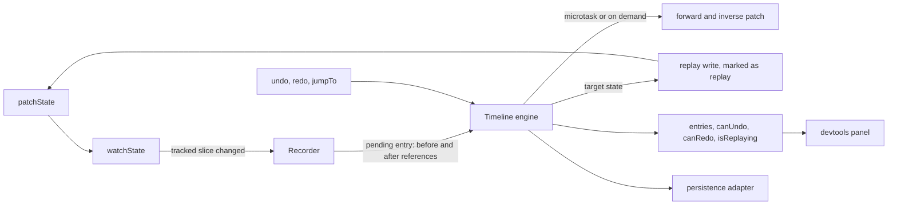

# signal-timeline

Undo, redo, transactions, a branching undo tree, history shared across stores and a time-travel panel for NgRx SignalStore. History is stored as patches, so memory stays small on large states.


Live demo: https://adrianturbinski.github.io/signal-timeline/ (a placeholder until the repository is pushed and Pages is switched on). The API reference is at `/api/` on the same site.

[](https://github.com/adrianturbinski/signal-timeline/actions/workflows/ci.yml)

[](LICENSE)
[](https://www.npmjs.com/package/signal-timeline)

The package is not on npm yet and nothing has run on GitHub, so the CI and npm badges stay empty until the first push and the first release.

## Why I built this

I work with signals based Angular every day, and the diagram editors I build at work need undo that never loses a step. SignalStore already has linear undo (`withUndoRedo` in `@ngrx-toolkit/core`), and for many apps that is enough. An editor wants more. A change made after an undo should not destroy the redo history, one gesture that touches two stores should undo as one step, and moving through history should not save the document to a server again.

So this library starts where linear undo stops: a branching tree, transactions, history across several stores, and time travel that leaves side effects alone. Everything is written from scratch, and the demo is a small SVG editor made for this project.

<!-- ADRIAN: add one or two sentences of your own here, for example the bug in a real editor that made you want this, or what you would tell a colleague who asks why undo is harder than it looks. -->

## What it looks like in code

```ts
import { signalStore, withState } from '@ngrx/signals';
import { withEntities } from '@ngrx/signals/entities';
import { withTimeline } from 'signal-timeline';

export const EditorStore = signalStore(
  { providedIn: 'root' },
  withState({ selectedId: null as string | null }),
  withEntities<Shape>(),
  withTimeline({
    skip: ['selectedId'],
    maxEntries: 500,
    label: (change) => `Edit ${change.changedKeys.join(', ')}`,
  }),
);
```

The store gets `undo()`, `redo(branchId?)`, `jumpTo(entryId)`, `clear()`, `transaction(label, fn)`, the signals `canUndo`, `canRedo`, `entries`, `currentEntryId`, `redoBranches` and `isReplaying`, and `entryPatch(id)` for the forward and inverse patch of an entry. Option keys such as `skip` and `track` are typed against the store's state, so a misspelled key does not compile.

```html
<st-devtools [timeline]="store" />
```

The panel comes from `signal-timeline/devtools`. It needs `moduleResolution` set to `bundler`, or `node16` and newer (ADR 0012).

## What's hard about it

### Effects must stay quiet during undo

An `effect` that saves the document runs after `patchState`, in the next change detection pass. A boolean that is true only while the timeline writes the state is already false by then. The timeline keeps a replay window that closes after the next render, and `skipReplay` and `ignoreReplays` read it for `effect`, `signalMethod` and `rxMethod`. The tests run all four kinds of listener across undo, redo, jump and a live change, with zoneless and zone based change detection, and a deliberately broken helper makes them fail. Details are in [replay and side effects](docs/guides/replay-and-side-effects.md) and ADR 0007.

### Recording has to stay cheap on large state

`patchState` is a free function, so the library cannot wrap it and records through `watchState`. Diffing a 10,000 entity map inside that callback would put a full scan on every write. A new entry keeps only the before and after references, and the patches are computed in a microtask or when something asks for them. ADR 0006 has the reasoning, and the benchmarks below give both costs.

### Jumping on a long history

Applying patches one by one from the start is slow, and a snapshot per entry is large. A checkpoint every 250 entries (a reference to a structurally shared state, not a copy) bounds the walk, and a jump concatenates the operations of its whole route and applies them in one copy on write call. See ADR 0005.

### Branches and pruning

A change after an undo adds a child to the current node instead of dropping the redo history. `maxEntries` then has to remove history without breaking the tree. It drops the oldest leaf that is not on the path to the current entry, and advances the root when the history is linear. Property tests check the tree invariants over random sequences with a small limit.

### One undo for several stores

`provideTimelineGroup()` runs one engine over a composite state keyed by store, so patch paths start with the store key. A replay writes all stores together, and if one throws, every store goes back to its previous slice. See [groups](docs/guides/groups.md) and ADR 0009.

## How it works



Each entry has a forward patch $P_e$ that turns its parent state $S_p$ into $S_e$, and an inverse patch $P_e^{-1}$ that turns it back. Both are RFC 6902 style (`add`, `remove`, `replace`). The diff skips every subtree whose reference did not change, so a change to one entity in a map costs a scan of that map's keys and nothing below them. Two properties are tested over random sequences with fast-check:

$$P_e^{-1}(P_e(S_p)) = S_p \qquad\qquad \mathrm{redo}^k(\mathrm{undo}^k(S)) = S$$

The tree has one root, "Initial state", and every other node has exactly one parent. Redo follows the branch visited last, or the one you pick. With $d$ the path length between the current entry and the target and $k$ the checkpoint interval, a jump applies about $\min(d, k)$ patches.

More in [patches, the tree and checkpoints](docs/guides/patches-and-the-tree.md), [persistence](docs/guides/persistence.md) and [groups](docs/guides/groups.md).

## Validation and benchmarks

Every number in this section comes from `bench/results/summary.md`, which `pnpm bench:report` generates from the JSON files that `pnpm bench` writes. The benchmarks use tinybench and print the hardware and engine they ran on. They ran on 2026-10-04 on a laptop shared with other jobs, so small differences are noise.

Hardware: 12th Gen Intel Core i7-12700H, 20 logical cores, 15 GB RAM, Linux 6.6 on WSL2. Engines: Node 24.21.0 and Chromium 153.0.8010.12 (headless, through Playwright).

### Recording overhead on a state with 10,000 entities

The target is under 0.1 ms per typical `patchState`. The figures are the median of paired differences between a plain store and a store with the feature, in Node:

| operation | extra time on the `patchState` call | patches computed afterwards |
| --- | --- | --- |
| `updateEntity` (string ids) | 0.005 ms | 1.185 ms in total |
| `addEntity` | 0.012 ms | 1.183 ms in total |
| `removeEntity` | 0.027 ms | 1.364 ms in total |
| `updateEntity` with the history full at 100 entries | 0.028 ms | 1.170 ms in total |

The target holds for the call itself. It does not hold for the work after it. Computing the patch of one entity update in a 10,000 entity map takes about 1.2 ms in Node (7.9 ms at 50,000 entities), because a diff has to look at every key. That work runs in a microtask and is not hidden. Chromium's timer resolution is 0.1 ms in this setup, so the same median reads 0.000 there and the Node figure is the precise one.

### History size after 10,000 small edits

The target is a history at least 10 times smaller than full states, as serialized size and as heap. The baseline keeps one structurally shared full state per edit.

| entities | serialized ratio | heap, history | heap, snapshots | heap ratio |
| --- | --- | --- | --- | --- |
| 100 | 23.4 | 11.41 MB | 6.63 MB | 0.6 |
| 1,000 | 235.1 | 11.93 MB | 54.77 MB | 4.6 |
| 10,000 | 2006.4 | 26.62 MB | 2626.62 MB | 98.7 |

The serialized target is met at every size. The heap target is met only at 10,000 entities. On small states the shared snapshots cost less memory than my entries, which carry a node, two patches and a label each, so with a hundred entities you do not need patches to save memory. Chromium gives the same picture (0.5, 4.4 and 96.4).

### Navigation

10,000 entries over 1,000 entities, `checkpointEvery` 250, Node:

| operation | p50 | p99 |
| --- | --- | --- |
| undo | 0.021 ms | 0.049 ms |
| jump to a random entry | 0.595 ms | 1.263 ms |
| jump to the initial state | 0.528 ms | 0.889 ms |

On 10,000 entities with 3,000 entries a jump takes about 3 to 4 ms, mostly the copy of the entity map that applying any patch to it costs. Saving the whole history of 10,000 entries (2.7 million characters of JSON) takes 16.6 ms and loading it 58.3 ms in Node. The summary file has the full tables, including the checkpoint interval sweep behind the default.

### Other checks

`pnpm verify:must-haves` runs 31 checks against the packed tarball and the production demo (jsdom with real Angular DI for the library, Chrome for the demo). `node tools/lighthouse.mjs` audits the production build of the demo and fails below an accessibility score of 95. Lighthouse only sees the empty editor, so the Cypress suite runs axe in five states as well.

## Run it locally

You need Node 24.15 or newer and pnpm 12 (`corepack enable` provides the pinned version).

```sh
git clone https://github.com/adrianturbinski/signal-timeline && cd signal-timeline
pnpm install
pnpm start
```

`pnpm start` builds the library and serves the demo editor on http://localhost:4200/.

## Tests

| command | what it runs |
| --- | --- |
| `pnpm test` | 548 library tests and 114 demo tests with Vitest |
| `pnpm test:coverage` | the same with coverage and a gate: 90 percent of lines in `src/core`, 80 percent elsewhere |
| `pnpm test:types` | type tests with expect-type, including option keys restricted to state keys |
| `pnpm test:e2e` | 25 Cypress tests against the production build: draw, undo, redo, branch, scrub, tree keys, reload, keyboard only drawing, axe, no horizontal scroll at 360, 390 and 768 px |
| `pnpm bench:smoke` | a short run of every benchmark suite |
| `pnpm compat 21` | unit tests, type tests and the library build with Angular 21 and @ngrx/signals 21 |
| `pnpm consumer 21`, `pnpm consumer 22` | a fresh Angular app of that major installs the packed tarball, builds for production and runs 3 tests |
| `pnpm verify` | everything the CI job runs, in order |

The property tests (fast-check) cover the five properties from the brief: undo then redo is the identity, a patch followed by its inverse is the identity, `jumpTo` equals replaying from the start, a transaction with a net change is exactly one entry, and the tree invariants hold. They also run model based sequences with pruning, persistence and groups. The default is 200 runs per property, and `FC_NUM_RUNS` raises it. Line coverage on the last run was 98.4 percent for the library and 97.0 percent for the demo.

The CI matrix runs the unit tests and the library build on Angular 21 with @ngrx/signals 21 and on Angular 22 with @ngrx/signals 22. I could not run the workflows as a whole (`act` is not installed here and nothing was pushed), so every command in them was run locally and the files were linted with actionlint.

## Design decisions

Each decision has a short record in `docs/adr/` with the context, the alternatives and the consequences.

- [0001](docs/adr/0001-angular-cli-workspace-pnpm-node-24.md) Angular CLI workspace with pnpm and Node 24
- [0002](docs/adr/0002-toolchain-lines-and-angular-compatibility.md) two toolchain lines and the compatibility rule
- [0003](docs/adr/0003-vitest-over-jest-and-type-tests.md) Vitest instead of Jest, type tests with expect-type
- [0004](docs/adr/0004-patches-and-structural-diff.md) patches and the structural diff
- [0005](docs/adr/0005-history-tree-checkpoints-and-jumping.md) history tree, checkpoints and jumping
- [0006](docs/adr/0006-recording-through-watchstate-with-deferred-patches.md) recording through `watchState` with deferred patches
- [0007](docs/adr/0007-replay-marker-and-side-effects.md) replay window and side effects
- [0008](docs/adr/0008-transactions-and-coalescing.md) transactions and coalescing
- [0009](docs/adr/0009-timeline-groups-as-composite-state.md) timeline groups as a composite state
- [0010](docs/adr/0010-persistence-format-and-adapters.md) persistence format and adapters
- [0011](docs/adr/0011-devtools-scrubber-and-aria-tree-in-svg.md) devtools scrubber and an ARIA tree drawn in SVG
- [0012](docs/adr/0012-package-layout-and-release.md) package layout, API docs and release
- [0013](docs/adr/0013-dependency-license-policy.md) dependency license policy
- [0014](docs/adr/0014-benchmarks-measured-targets-and-tuning.md) benchmarks, measured targets and tuning
- [0015](docs/adr/0015-demo-editor-interaction-and-history-decisions.md) demo editor decisions
- [0016](docs/adr/0016-prior-art-and-positioning.md) prior art and how this README compares
- [0017](docs/adr/0017-demo-recording.md) recording the demo GIF
- [0018](docs/adr/0018-verification-and-readme-numbers.md) verification, README numbers and the coverage badge

## How it compares

I read the published source of the closest projects on 2026-10-04 and limit this to what I checked.

`withUndoRedo` in `@ngrx-toolkit/core` 22.0.1 is the closest. It keeps an undo stack and a redo stack of snapshots of the tracked keys, and a new change clears the redo stack. It has no branches, transactions or history across stores. `signalstory` 22.0.0 has transactions and history across stores, but with its own store classes instead of SignalStore. `ngrx-wieder` 17.0.0 builds undo and redo on Immer patches for the classic NgRx Store, which this project leaves out of scope.

One result surprised me. In `withUndoRedo` 22.0.1 the `maxStackSize` option did not limit anything in my test. With `maxStackSize: 3`, 20 edits and then undo until `canUndo` is false, it took 20 undos. `pnpm prior-art` repeats that on the exact version and accepts another package spec to check a newer release. I have not reported it upstream. I did not benchmark the other libraries, so this README makes no claim about speed or size relative to them. ADR 0016 has the details.

## Limitations and what I would do next

- State must be immutable plain data. Dates, Maps and class instances are treated as atomic values, and persisted state must be JSON safe (`undefined` object values are lost). In development the recorder warns once per root key when it sees a value that is not plain data.
- The diff has no move detection. Reordering a long array produces a patch the size of the changed middle.
- Undo and redo belong in event handlers and methods. A replay started from inside an effect closes its replay window one render too late, so the effects it triggers are not skipped.
- A transaction that ends where it started creates no entry, because an empty entry would only clutter the tree (ADR 0008).
- Pruning with `maxEntries` can drop whole branches.
- `entries()` is rebuilt on every change, so it is linear in the number of entries. It took 0.26 ms at p50 after an edit with 10,000 entries in the benchmark.
- Every persistence save writes the whole history. Persisted history is validated by replaying its forward patches, but I do not check that an inverse patch really inverts its forward patch, so a hand edited payload can make an undo land on the wrong state.
- `migrate` for persisted history exists as a hook only. Typed migration between versions was cut, along with the Redux DevTools bridge and the hooks for merging remote changes, because the must-haves came first.
- The demo is built for a pointer or a keyboard on a laptop, and shape names are small on a 360 px screen. I tested the ARIA tree with axe and keyboard tests but not with a screen reader, and `role="tree"` on SVG is less uniformly supported than on HTML. ADR 0011 names the fallback, a visually hidden HTML list.
- Peer dependencies are Angular 21 or 22 and @ngrx/signals 21 or 22.

Next I would test the tree with a screen reader, make `entries()` incremental and add a typed migration for persisted history.

## Credits and license

Third party packages and the prior art I read are listed in [CREDITS.md](CREDITS.md). The code, the favicon and the demo shapes are original work. MIT, see [LICENSE](LICENSE).
